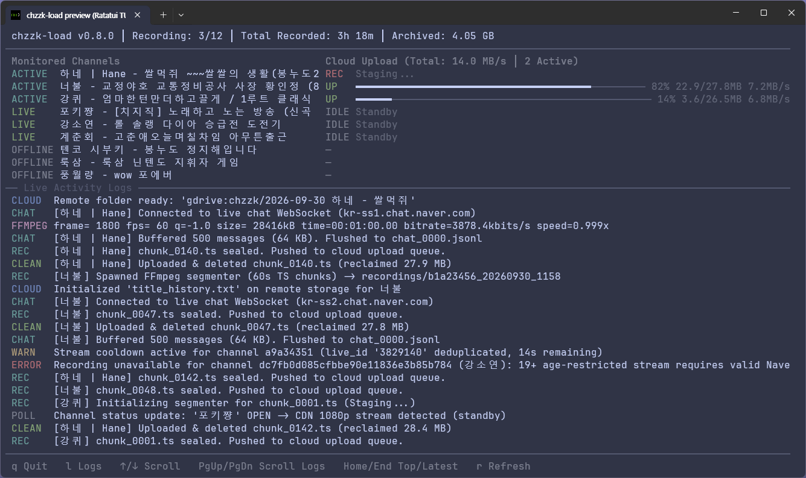

# chzzk-load

[English](README.md) | **한국어**

[](https://www.npmjs.com/package/chzzk-load)
[](https://github.com/ghfhffh12345/chzzk-load/releases)
[](https://github.com/ghfhffh12345/chzzk-load/actions/workflows/ci.yml)
[](LICENSE)

네이버 치지직(Chzzk) 라이브 방송을 자동으로 감지하여 실시간 영상 및 라이브 채팅을 녹화하고, 녹화 후 미디어 통합 및 클라우드 스토리지([rclone](https://rclone.org/) 연동)로 동기화하는 고성능 독립 실행형 CLI 도구입니다. [Ratatui](https://github.com/ratatui/ratatui) 기반의 대화형 터미널 사용자 인터페이스(TUI)를 제공합니다.

`chzzk-load`는 방송 상태를 실시간 모니터링하며, FFmpeg 스트림 복사(`-c copy`)를 통해 원본 손실 없이 영상을 MPEG-TS 세그먼트로 분할 저장하고 WebSocket을 통해 실시간 라이브 채팅을 구조화된 JSON Lines(`chat_%04d.jsonl`) 형식으로 동시 수집합니다. 분할 완료된 영상 세그먼트와 채팅 로그는 백그라운드에서 rclone을 통해 클라우드 스토리지로 즉시 업로드되며 (또는 로컬 전용 모드로 로컬에 보관), 업로드 성공이 확인되는 즉시 로컬 파일을 삭제하여 디스크 사용량을 최소한으로 엄격히 유지합니다. 또한 분할 저장된 청크들을 재생 탐색이 가능한 단일 MP4(`livestream.mp4`, `+faststart`) 및 중복 제거된 채팅 로그(`livechat.jsonl`)로 무손실 통합하는 녹화 후 통합 파이프라인(`chzzk-load consolidate`)을 제공합니다.



---

## 주요 기능

- ⚡ **무손실 스트림 복사 및 깔끔한 정상 종료 (`-c copy`)**: 라이브 HLS 비디오 스트림을 재인코딩 없이 원본 그대로 `.ts` 조각으로 분할하여 CPU 및 메모리 부하를 최소화합니다. 재연결 플래그를 생략하여 방송 종료 시 HLS 매니페스트 EOF 무한 재시도 루프를 원천 차단합니다.
- 🌐 **직접 CDN 스트림 주소 자동 추출 (P2P/그리드 우회)**: 치지직 `p2pPath` 플레이리스트에 포함된 base64 인코딩 `cdn_url` 매개변수를 자동 디코딩하여, 별도의 그리드 소프트웨어 설치 없이 원본 화질(1080p, 720p 등)의 직접 CDN HLS 스트림을 수집합니다.
- 💬 **실시간 라이브 채팅 녹화 (`chat_%04d.jsonl`)**: WebSocket을 통해 실시간 방송 채팅을 동시 수집하여 시간 단위 분할 세그먼트(`chat_%04d.jsonl`)로 저장하며, 타임스탬프, 사용자 닉네임, 뱃지, 후원(치즈) 내역, 메시지 내용이 포함된 구조화된 JSON Lines 형식을 유지합니다.
- 💽 **플래시 수명 보호 배치 I/O (SBC 최적화)**: 라즈베리 파이(Raspberry Pi), ARM64 등 단일 보드 컴퓨터(SBC)의 microSD 및 플래시 메모리 수명을 보존하기 위해 바이트 버퍼 메모리 버퍼링 및 듀얼 트리거 플러시(500개 메시지 / 64KB 도달 또는 주기적 타이머)를 적용하여 디스크 쓰기 빈도를 최소화합니다.
- 📊 **실시간 방송 메타데이터 이벤트 추적 (`livemetadata.jsonl`)**: 방송 중 변경되는 핵심 상태 전이(방제, 카테고리, 태그, 시청 권한 등급, 시청 및 채팅 정책 플래그)를 v2 경량 JSON Lines 스냅샷 형식으로 밀리초 단위의 비디오 싱크와 함께 기록하고, 통합 비차단 업로드 파이프라인을 통해 실시간 클라우드 동기화를 지원합니다.
- 💾 **엄격히 제한된 디스크 사용량 & 디스크 고갈 보호**: 활성 스트림당 최대 1~2개의 영상 세그먼트 및 1개의 채팅 청크만 로컬 디스크에 유지합니다. 클라우드 업로드 완료가 확인되는 즉시 세그먼트 청크는 로컬에서 영구 삭제됩니다. 크로스 플랫폼 디스크 공간 서킷 브레이커(`min_free_disk_gb`)가 작동하여 잔여 용량이 부족할 경우 녹화를 안전하게 일시 정지하고 메타데이터는 안전하게 보존하면서 데드 레터 큐(DLQ)에서 가장 오래된 실패 청크들을 능동적으로 삭제하여 디스크 공간을 확보합니다.
- 🛡️ **N+1 세그먼트 경계 안전성**: 명시적 숫자 시퀀스 파싱(`chunk_%04d.ts`)을 통해 $N$번째 청크는 다음 $N+1$번째 청크가 디스크에 생성(파일 크기 > 0)된 것이 확인된 후에만 업로드 큐로 전달되어, 불완전하거나 손상된 청크의 업로드를 원천 차단합니다.
- 🎬 **녹화 후 미디어 통합 (`chzzk-load consolidate`)**: 분할된 영상 세그먼트(`chunk_%04d.ts`)를 탐색 가능한 타임라인 정규화 MP4(`livestream.mp4`, `+faststart`)로 무손실 리먹싱하고 채팅 로그를 단일 `livechat.jsonl`로 중복 제거 통합합니다. 로컬 디렉터리와 클라우드 원격지(`remote:path`)를 모두 지원하며, 원격 청크를 임시 HTTP 루프백 서버(`rclone serve http`)로 메모리에 스트리밍하여 로컬 디스크 사용량을 영상 크기의 1배로 엄격히 제한합니다.
- 🚀 **고처리량 동시 클라우드 업로드 및 복원력 있는 스테이징**: 통합 완료된 `livestream.mp4`와 `livechat.jsonl`을 2단계 원자적 스테이징(`.part` 업로드 후 `rclone moveto`)으로 동시 업로드하며, 대용량 파일 전송 최적화(`--drive-chunk-size 128M`, 멀티스레딩)가 적용됩니다. 업로드 실패 시 형제 프로세스 즉시 중단 및 원격 `.part` 정리, 컨테이너 정밀 검증(`moov` 아톰)을 통한 즉각적인 재개 지원, 사전 디스크 용량 검증($1.15\times$ 확보)을 갖추고 있습니다.
- 📊 **반응형 미디어 통합 진행률 텔레메트리**: 리먹싱(`VID`, `CHAT`), 클라우드 업로드(`UP V`, `UP C`), 청크 정리(`DEL`) 상태를 10 Hz 갱신 주기의 대화형 TrueColor ANSI 게이지바로 실시간 표시하며, 비대화형/헤드리스 환경에서는 20% 마일스톤 로그 및 30초 생존 주기 로그로 자동 전환됩니다.
- 📬 **비차단 데드 레터 큐 (DLQ) 재시도 구조**: 개별 청크나 메타데이터 업로드가 실패하더라도 후속 작업이 차단(Head-of-Line Blocking)되지 않고 백그라운드 DLQ로 즉시 이관되어 지수 백오프(초기 2초, 최대 5분 캡, 무한 재시도, 채널당 메모리 내 최대 20개 태스크 제한)로 재시도됩니다.
- 🔄 **비정상 종료 자동 복구 및 꼬리 청크 격리**: 프로그램 비정상 종료나 서버 재부팅 시 이전 세션의 고아 청크 및 잔여 `livemetadata.jsonl`을 자동 스캔하여, N+1 검증이 완료된 완전한 청크와 메타데이터는 데드 레터 큐(DLQ)로 재주입하여 업로드하고 미완성된 마지막 꼬리 청크는 안전하게 격리(`.quarantine`)합니다.
- 🤖 **헤드리스 콘솔 모드 (`--headless` / `--no-tui`)**: 비대화형 환경(non-TTY, Docker 컨테이너, systemd 서비스 등)을 자동 감지하거나 플래그를 통해 TUI 원시 모드를 건너뛰고 포맷팅된 실시간 로그를 stdout으로 스트리밍합니다.
- ☁️ **Rclone 기반 다양한 클라우드 스토리지 동기화**: [rclone](https://rclone.org/)과 연동하여 Google Drive, OneDrive, Amazon S3, Dropbox, WebDAV, SFTP 등 70여 개 이상의 다양한 클라우드 스토리지로 원활하게 전송합니다. 클라우드 동기화를 비활성화(`remote_path: ""`)하면 자동으로 **로컬 전용 녹화 모드**로 동작합니다.
- 🔀 **채널별 순차 직렬화 & 다중 스트림 동시 업로드**: 동일 채널의 세그먼트는 순차(FIFO) 업로드를 보장하여 순서 꼬임과 대역폭 경합을 방지하며, 여러 채널 간에는 최대 `upload_concurrency`(기본값: 3)개까지 병렬 업로드합니다.
- 🖥️ **이벤트 기반 터미널 대시보드 (TUI)**: `crossterm::event::EventStream` 기반의 비동기 이벤트 루프와 제로 메모리 할당 렌더링으로 유휴 CPU 점유율을 0으로 억제하며, 실시간 채널 상태, 방송 제목, 실시간 수집 채팅 수 카운터, 업로드 진행률 게이지, 전송 속도 지표, 헤더 요약 통계(활성 녹화 수, 누적 녹화 시간, 아카이브 용량), 로그 토글 기능(`l` 키), Windows 콘솔 UTF-8 코드페이지 자동 설정을 지원합니다.
- 🔄 **CDN 캐시 지연 중복 방지 (Anti-Race)**: 방송 종료 후 쿨다운 적용 및 방송 고유 세션 ID(`live_id`) 추적을 통해 치지직 CDN 캐시 지연(10~30초)으로 인한 중복 세션 생성을 방지합니다.

---

## 사전 요구사항

- **FFmpeg**: 시스템의 `PATH` 환경 변수에 등록되어 있어야 합니다 (또는 `CHZZK_LOAD_FFMPEG_BIN` 환경 변수로 실행 파일 경로 지정 가능).
- **Rclone**: (로컬 전용 모드에서는 선택 사항, 클라우드 업로드 사용 시 필수) 시스템의 `PATH`에 등록되어 있어야 합니다 (또는 `settings.toml`의 `rclone.rclone_bin` 또는 `CHZZK_LOAD_RCLONE_BIN` 환경 변수로 실행 파일 경로 지정 가능).

```bash
ffmpeg -version
rclone version
```

---

## 설치 및 빠른 시작

npm을 통해 글로벌로 설치합니다:

```bash
npm install -g chzzk-load
```

애플리케이션 실행:

```bash
# 기본 설정으로 실행 (설정 파일이 없으면 자동으로 settings.toml 템플릿 생성)
chzzk-load

# 또는 사용자 지정 설정 파일 경로 지정
chzzk-load --config /path/to/my-settings.toml

# 또는 시작 시 원격지 연결 확인 건너뛰기
chzzk-load --skip-rclone-check

# 백그라운드 헤드리스 모드로 실행 (systemd 서비스 / Docker 환경 최적화)
chzzk-load --headless

# 로컬 녹화 세션 디렉터리 무손실 통합
chzzk-load consolidate recordings/[2026-09-30_140000]\ [StreamerAlias]\ StreamerName\ -\ Live\ Stream\ Title

# 클라우드 스토리지에 저장된 원격 녹화 세션 무손실 통합
chzzk-load consolidate remote:chzzk/[2026-09-30_140000]\ [StreamerAlias]\ StreamerName\ -\ Live\ Stream\ Title
```

최초 실행 시 현재 작업 디렉터리에 `settings.toml` 파일이 존재하지 않는 경우 기본 템플릿이 자동으로 생성됩니다.

---

## 녹화 후 파일 통합 (`chzzk-load consolidate`)

방송 녹화가 완료된 후 세션 폴더에는 분할 영상 청크(`chunk_%04d.ts`), 분할 채팅 로그(`chat_%04d.jsonl`), 방송 메타데이터(`livemetadata.jsonl`)가 보관됩니다. `consolidate` 서브커맨드는 이러한 분할 파일들을 손실 없이 탐색 가능한 표준 규격 파일(`livestream.mp4` 및 `livechat.jsonl`)로 병합 및 리먹싱하며, 로컬 디스크 사용량을 엄격하게 제한합니다.

```bash
# 로컬 녹화 세션 디렉터리 무손실 통합
chzzk-load consolidate recordings/[2026-09-30_140000]\ [StreamerAlias]\ StreamerName\ -\ Live\ Stream\ Title

# 클라우드 스토리지에 저장된 원격 녹화 세션 무손실 통합
chzzk-load consolidate remote:chzzk/[2026-09-30_140000]\ [StreamerAlias]\ StreamerName\ -\ Live\ Stream\ Title

# 원본 영상 및 채팅 청크 유지 (성공 후 청크 자동 삭제 비활성화)
chzzk-load consolidate recordings/... --keep-original

# 대상 폴더에 이미 존재하는 livestream.mp4 또는 livechat.jsonl 강제 덮어쓰기
chzzk-load consolidate recordings/... --overwrite

# 청크 번호 누락이나 비정상 파일 발견 시 통합 즉시 중단
chzzk-load consolidate recordings/... --strict

# 다른 드라이브에 임시 스테이징 디렉터리 지정 (기본 시스템 드라이브 용량 부족 시 유용)
chzzk-load consolidate remote:chzzk/... --temp-dir /mnt/fast-nvme/staging

# 원본 청크 정리 시 최대 동시 삭제 작업 수 지정
chzzk-load consolidate remote:chzzk/... --delete-concurrency 32

# 헤드리스 모드로 통합 실행 (스크립트/cron을 위한 마일스톤 로깅)
chzzk-load --headless consolidate recordings/...
```

### 통합 CLI 옵션 목록

| 옵션 | 기본값 | 설명 |
| :--- | :--- | :--- |
| `<PATH>` | *(필수)* | 녹화 세션의 로컬 디렉터리 경로 또는 rclone 원격지 경로 (`<원격지이름>:<경로>`). |
| `--keep-original` | `false` | 통합 성공 후 원본 영상 및 채팅 청크를 삭제하지 않고 유지합니다. 지정하지 않으면 검증 완료 후 원본 청크가 자동 삭제됩니다. |
| `--overwrite` | `false` | 대상 디렉터리에 이미 존재하는 `livestream.mp4` 또는 `livechat.jsonl` 파일을 덮어씁니다. |
| `--strict` | `false` | 청크 시퀀스 누락(예: `chunk_0002.ts` 부재)이나 손상된 항목 감지 시 작업을 즉시 중단합니다. |
| `--delete-concurrency <N>` | `16` | 원본 청크 정리 시 실행할 최대 병렬 삭제 작업 수. |
| `--temp-dir <PATH>` | 시스템 임시 폴더 | 임시 스테이징 파일(`livestream.mp4.part`, `livechat.jsonl.part`)이 저장될 작업 디렉터리. |
| `-c`, `--config <PATH>` | 자동 감지 | rclone 바이너리, 원격지 경로 및 `consolidate_extra_args`를 불러올 `settings.toml` 설정 파일 경로. |

### 아키텍처 및 안전성 특징

- **무손실 Concat Demuxer 리먹싱 (`-c copy`)**: 원시 바이트 파이프 대신 FFmpeg의 내장 Concat Demuxer(`-f concat -safe 0`)를 사용하여 트랜스포트 스트림 패킷 경계를 온전히 보존하며, 영상 재인코딩이나 경계 프레임 유실 없이 무손실 병합합니다.
- **타임라인 정규화 및 단조 증가 DTS 보정**: `-avoid_negative_ts make_zero`를 적용하여 재생 시작 타임스탬프를 0.0초로 초기화함으로써 초기 재생 멈춤 및 싱크 어긋남을 방지합니다. 단조 증가 비트스트림 필터(`VIDEO_MONOTONIC_DTS_BSF`, `AUDIO_MONOTONIC_DTS_BSF` / `aac_adtstoasc`)가 청크 연결부의 DTS 충돌을 영상 재인코딩 없이 자동으로 보정합니다.
- **데스크톱 친화적 Faststart 탐색 테이블 (`+faststart`)**: `livestream.mp4` 파일의 앞부분에 `moov` 아톰 헤더를 재배치하여 데스크톱 플레이어(VLC, 팟플레이어, 퀵타임) 및 웹 브라우저에서 총 재생 시간 확인 및 즉각적인 탐색(스크러빙)을 지원합니다.
- **엄격히 제한된 1배 디스크 스테이징 (원격 청크 로컬 다운로드 배제)**: 원격 통합 시 청크들을 로컬 디스크에 저장하지 않고 임시 읽기 전용 HTTP 루프백 서버(`rclone serve http`)를 통해 메모리로 직접 스트리밍하며, 탐색 가능한 결과물(`livestream.mp4.part`)만 로컬에 기록하여 로컬 디스크 사용량을 영상 파일 크기의 1배로 엄격히 제한합니다.
- **사전 디스크 용량 검증**: 리먹싱을 시작하기 전 스테이징 경로의 여유 디스크 공간이 전체 영상 용량의 $1.15\times$ 이상인지 사전 검증하며, 용량이 부족할 경우 즉각 중단하고 해결 안내를 출력합니다.
- **컨테이너 구조 무결성 검증**: 스테이징 완료된 `.part` 파일 승격 및 업로드 재개 전 MP4 컨테이너 구조 무결성(`validate_mp4_container_integrity`)을 검증합니다: 단일 `moov` 아톰, 최소 1개의 `mdat` 아톰, 후속 미색인 잔여 데이터 없는 정확한 파일 경계 일치, 청크 오프셋(`stco`/`co64`)의 `mdat` 페이로드 내부 유효성을 확인합니다.
- **동시 클라우드 업로드 및 형제 프로세스 즉시 중단**: `livestream.mp4`와 `livechat.jsonl`을 대용량 전송 최적화 플래그(`--drive-chunk-size 128M`, 멀티스레딩)와 함께 병렬 업로드합니다. 하나의 업로드가 실패할 경우 형제 프로세스를 즉각 중단하고 원격 미완성 `.part` 파일을 정리하며 로컬 스테이징 파일은 유지하여 재실행 시 즉시 업로드를 재개할 수 있습니다.
- **슬라이딩 윈도우 채팅 중복 제거**: 영상 리먹싱과 병렬로 슬라이딩 윈도우 알고리즘을 수행하여 청크 경계에서 중복 수신된 채팅 메시지를 제거하고 $O(1)$ 메모리 사용량으로 시간 순서를 엄격히 유지합니다.
- **동시 원본 청크 정리**: 무손실 통합 및 클라우드 업로드 완료가 확인된 후 원본 `.ts` 및 `.jsonl` 파일들을 병렬(`--delete-concurrency 16`)로 빠르게 삭제하여 저장 공간을 신속히 회수합니다.

---

## 설정 가이드 (`settings.toml`)

```toml
# chzzk-load 설정 파일

[general]
chunk_duration_seconds = 600
poll_interval_seconds = 20
stream_cooldown_seconds = 60
recordings_dir = "recordings"
min_free_disk_gb = 2.0
record_chat = true
chat_flush_interval_seconds = 30

[rclone]
remote_path = "remote:chzzk"
upload_concurrency = 3
rclone_bin = "rclone"
skip_connection_check = false
extra_args = []
consolidate_extra_args = []

[chzzk]
nid_aut = ""
nid_ses = ""

# 채널별 별칭(alias)을 지정하여 모니터링:
[[channels]]
id = "4c3b44869c9b1399723ec28ec236f736"
alias = "SampleStreamer"

# 또는 축약형 문자열 배열로 모니터링 (공식 스트리머 이름이 API를 통해 자동 확인됨):
# channels = ["4c3b44869c9b1399723ec28ec236f736"]
```

### 주요 설정 항목

| 항목 | 기본값 | 설명 |
| :--- | :--- | :--- |
| `general.chunk_duration_seconds` | `600` (10분) | 분할 녹화할 영상 세그먼트의 길이(초 단위). |
| `general.poll_interval_seconds` | `20` | 치지직 라이브 방송 시작 여부를 확인하는 폴링 주기(초 단위). |
| `general.stream_cooldown_seconds` | `60` | 방송 종료 후 CDN 캐시 잔여로 인한 중복 녹화를 방지하기 위한 대기 시간(초 단위). |
| `general.recordings_dir` | `"recordings"` | 임시 세그먼트 영상 파일 및 채팅 로그가 저장되는 로컬 디렉터리 경로. |
| `general.min_free_disk_gb` | `2.0` | 녹화를 계속하기 위해 필요한 최소 여유 디스크 공간(GB 단위). |
| `general.record_chat` | `true` | `chat_%04d.jsonl` 시간 단위 세그먼트 청크로 실시간 라이브 채팅 동시 녹화 활성화 여부. |
| `general.chat_flush_interval_seconds` | `30` | 메모리에 버퍼링된 채팅 메시지를 디스크로 플러시하는 주기(초 단위). |
| `rclone.remote_path` | `"remote:chzzk"` | rclone 형식의 대상 원격지 및 경로 (`<원격지이름>:<경로>`). 빈 문자열(`""`)로 설정 시 **로컬 전용 녹화 모드**로 동작합니다. |
| `rclone.upload_concurrency` | `3` | 채널 간 동시 업로드 가능한 최대 스트림 수 (동일 채널 내 청크는 엄격한 FIFO 순서로 직렬 업로드됨). |
| `rclone.rclone_bin` | `"rclone"` | rclone 실행 파일의 경로 또는 명령어 이름. |
| `rclone.skip_connection_check` | `false` | 시작 시 원격지 연결 확인 건너뛰기 여부 (기본값에서는 백그라운드에서 10초 타임아웃으로 비동기 실행). |
| `rclone.extra_args` | `[]` | rclone 호출 시 전달할 추가 CLI 인자 목록 (예: `["--drive-chunk-size=64M"]`). |
| `rclone.consolidate_extra_args` | `[]` | 녹화 후 통합 클라우드 업로드 시 전달할 추가 CLI 인자 목록 (예: `["--drive-chunk-size=128M"]`), 실시간 청크 업로드와 분리되어 적용됨. |
| `chzzk.nid_aut` / `nid_ses` | `""` | 연령 제한 또는 구독자 전용 방송 녹화를 위한 네이버 로그인 세션 쿠키 값 (선택 사항). |
| `channels` | - | 모니터링할 치지직 채널 목록. `[[channels]]`에 `id` 및 선택적 `alias`를 지정하거나 축약형 문자열 `channels = ["<id>"]` 지정 가능 (공식 스트리머 이름이 API로부터 자동 확인됨). |

### SBC(라즈베리 파이 등) 권장 설정

microSD 카드를 사용하는 라즈베리 파이(Raspberry Pi) 및 ARM64 단일 보드 컴퓨터(SBC) 환경에서는 `recordings_dir`을 RAM 디스크(예: `/dev/shm/chzzk-load`)로 지정하고, 세그먼트 길이를 `120`초로 단축하며, `upload_concurrency`를 `2`로 설정하는 것을 적극 권장합니다.

`chzzk-load`는 클라우드 업로드 성공 시 로컬 세그먼트를 즉시 삭제하여 활성 스트림당 1~2개의 영상 세그먼트 및 활성 채팅 청크만 디스크에 유지하므로, `/dev/shm`을 임시 디렉터리로 사용하면 영상 및 채팅 세그먼트가 메모리에만 기록된 후 클라우드 스토리지로 직접 전송되어 microSD 및 플래시 메모리의 쓰기 수명 마모를 완전히 방지할 수 있습니다:

```toml
[general]
chunk_duration_seconds = 120
poll_interval_seconds = 20
stream_cooldown_seconds = 0
recordings_dir = "/dev/shm/chzzk-load"
min_free_disk_gb = 2.0
record_chat = true
chat_flush_interval_seconds = 30

[rclone]
remote_path = "remote:chzzk"
upload_concurrency = 2
rclone_bin = "rclone"
extra_args = []

[chzzk]
nid_aut = ""
nid_ses = ""

[[channels]]
id = "4c3b44869c9b1399723ec28ec236f736"
alias = "SampleStreamer"
```

- **`recordings_dir: "/dev/shm/chzzk-load"`**: Linux 공유 메모리(RAM 디스크 / tmpfs)를 사용하여 microSD 및 플래시 메모리에 대한 쓰기 작업을 원천 차단합니다.
- **`chunk_duration_seconds: 120`**: 청크 길이를 2분으로 단축하여 1080p60 기준 약 50~100MB 크기로 유지함으로써 저용량 SBC RAM에서도 부담 없이 안전하게 동작합니다.
- **`stream_cooldown_seconds: 0`**: 세션 간 불필요한 쿨다운 대기 시간을 제거합니다.
- **`upload_concurrency: 2`**: 동시 업로드 수를 2개로 제한하여 저사양 기기에서의 CPU 및 네트워크 대역폭 경합을 방지합니다.
- **`chat_flush_interval_seconds: 30`**: 실시간 채팅 메시지를 메모리에 버퍼링한 후 주기적으로 기록하여 디스크 I/O 빈도를 최소화합니다.

---

## 데이터 포맷 및 파일 규격

각 녹화 세션은 `[{timestamp}] [{alias}] {streamer_name} - {title}` 형식의 전용 디렉터리를 생성합니다. 실시간 녹화 중에는 분할 영상 세그먼트, 시간 분할된 채팅 로그 및 방송 상태 전이 메타데이터 이벤트를 저장합니다:

```
recordings/
└── [2026-09-30_140000] [StreamerAlias] StreamerName - Live Stream Title/
    ├── chunk_0000.ts          # 영상 세그먼트 (무손실 MPEG-TS 스트림카피)
    ├── chunk_0001.ts
    ├── chat_0000.jsonl        # 채팅 로그 세그먼트 (JSON Lines)
    ├── chat_0001.jsonl
    └── livemetadata.jsonl     # 방송 메타데이터 상태 전이 및 비디오 싱크 타임라인
```

`chzzk-load consolidate`를 실행하여 통합을 완료하면, 원본 청크들이 정리(단, `--keep-original` 지정 시 유지)되고 탐색 가능한 단일 통합 파일로 대체됩니다:

```
recordings/
└── [2026-09-30_140000] [StreamerAlias] StreamerName - Live Stream Title/
    ├── livestream.mp4         # 통합된 탐색 가능 MP4 영상 (타임라인 정규화, +faststart moov 아톰)
    ├── livechat.jsonl         # 통합 및 중복 제거된 전체 채팅 로그 (JSON Lines)
    └── livemetadata.jsonl     # 방송 메타데이터 상태 전이 및 비디오 싱크 타임라인
```

---

### 1. 실시간 라이브 채팅 포맷 (`chat_%04d.jsonl`)

WebSocket을 통해 수집된 라이브 채팅 메시지는 구조화된 JSON Lines 형식으로 직렬화되어, 영상 세그먼트 시간(`chunk_duration_seconds`)에 맞춰 순차적인 번호의 청크 파일(`chat_%04d.jsonl`)로 분할 저장됩니다.

#### 필드 스키마

| 필드 | 타입 | 설명 |
| :--- | :--- | :--- |
| `time_ms` | `number` | 치지직 서버에서 메시지가 전송된 Unix 밀리초 타임스탬프. |
| `datetime` | `string` | 로컬 시간 기준 포맷팅 문자열 (`YYYY-MM-DD HH:mm:ss`). |
| `msg_type` | `string` | 메시지 분류: `"TEXT"`, `"DONATION"`, `"SUBSCRIPTION"`, `"SYSTEM_MESSAGE"`, 또는 `"TYPE_{code}"`. |
| `nickname` | `string` | 메시지 작성자의 닉네임. |
| `user_id_hash` | `string \| null` | 치지직 API가 제공하는 익명화된 유저 ID 해시 값. |
| `content` | `string` | 채팅 메시지 본문 텍스트. |
| `donation_amount` | `number \| null` | 후원 치즈 수량 (`"DONATION"` 메시지일 때만 포함되며 일반 채팅은 `null`). |
| `extras` | `object \| null` | 유저 뱃지, 구독 등급, 이모티콘 및 결제 상세 정보가 포함된 파싱된 JSON 객체. |
| `raw` | `object` | 치지직 채팅 WebSocket 서버로부터 전달받은 전체 원본 JSON 페이로드. |

#### 레코드 예시 (일반 채팅)

```json
{
  "time_ms": 1790757912345,
  "datetime": "2026-09-30 14:05:12",
  "msg_type": "TEXT",
  "nickname": "ChzzkViewer",
  "user_id_hash": "a1b2c3d4e5f6789012345678abcdef01",
  "content": "나이스 플레이!",
  "donation_amount": null,
  "extras": {
    "chatType": "STREAMING",
    "emojis": {},
    "osType": "PC",
    "streamingChannelId": "4c3b44869c9b1399723ec28ec236f736",
    "userRoleCode": "common_user"
  },
  "raw": { "cmd": 93101, "bdy": [], "tid": "1" }
}
```

#### 레코드 예시 (치즈 후원)

```json
{
  "time_ms": 1790757920123,
  "datetime": "2026-09-30 14:05:20",
  "msg_type": "DONATION",
  "nickname": "CheeseLover",
  "user_id_hash": "b2c3d4e5f6a1789012345678abcdef02",
  "content": "오늘 방송 화이팅! 1,000 치즈 후원합니다!",
  "donation_amount": 1000,
  "extras": {
    "donationType": "CHAT",
    "payAmount": 1000,
    "payType": "CURRENCY"
  },
  "raw": { "cmd": 93102, "bdy": [], "tid": "2" }
}
```

---

### 2. 방송 메타데이터 및 동기화 타임라인 포맷 (`livemetadata.jsonl`)

`livemetadata.jsonl`은 방송 중 일어나는 핵심 상태 전이(방제 변경, 카테고리 전환, 시청 권한, 정책 플래그 등)를 밀리초 단위의 비디오 싱크 타임라인(`stream_offset_ms`)과 함께 기록하는 경량(v2) 추가 전용(append-only) JSON Lines 이벤트 스트림입니다. 로컬 디스크에 순차 추가(append)됨과 동시에 통합 업로드 파이프라인(`rclone copyto`)을 통해 클라우드 스토리지로 실시간 동기화됩니다. 실시간 방송 중에는 로컬에 파일을 보존하며(`delete_on_success: false`), 방송 종료 시 최종 메타데이터 업로드 완료 후 로컬 파일이 자동 삭제(`delete_on_success: true`)되어 세션 폴더의 완전한 비움(Strict Directory Emptiness)을 보장합니다.

#### 이벤트 유형

- **`INITIAL_STATE`**: 녹화 세션 시작 시 1회 기록(`stream_offset_ms: 0`), 방송의 초기 경량 상태 스냅샷을 캡처합니다.
- **`METADATA_CHANGED`**: 모니터링 중 추적 대상 필드가 변경될 때마다 발행되며, 최신 방송 상태 스냅샷(`state`)을 담고 있습니다.

#### 엔벨로프(Envelope) 스키마

| 필드 | 타입 | 설명 |
| :--- | :--- | :--- |
| `version` | `number` | 스키마 버전 (`2`). |
| `event` | `string` | 이벤트 구분 식별자: `"INITIAL_STATE"` 또는 `"METADATA_CHANGED"`. |
| `timestamp` | `string` | RFC 3339 / ISO 8601 표준 UTC 타임스탬프 (`YYYY-MM-DDTHH:mm:ssZ`). |
| `stream_offset_ms`| `number` | 녹화 시작 시점으로부터 경과된 밀리초(ms) 단위 시간 (시작 시 `0`). MPEG-TS 비디오 타임라인과 밀리초 단위로 정확히 동기화됩니다. |
| `state` | `object` | 상태 전이 발생 직후의 완전한 경량 방송 상태 스냅샷. |

> [!NOTE]
> 버전 2에서는 중복 로컬 타임스탬프(`time_local`) 및 델타 diff 객체(`changes`)가 제거되고 완전한 경량 스냅샷(`state`)으로 단일화되었습니다.

> [!NOTE]
> **통합 업로드 파이프라인 및 DLQ 보호**: 메타데이터 스냅샷은 `rclone copyto ... --progress`를 통해 주 업로드 큐 및 데드 레터 큐(DLQ)로 전송되며, 전역 채널 동시성 제한(`upload_concurrency`)을 공유합니다. 네트워크 장애나 디스크 부족 시에도 지수 백오프로 재시도되며, DLQ 디스크 압박 제거 대상에서 엄격히 제외되어 방송 변경 이력이 유실되지 않습니다.

#### 방송 상태 스냅샷 스키마 (`state`)

| 필드 | 타입 | 설명 |
| :--- | :--- | :--- |
| `live_id` | `number \| null` | 방송 세션 고유 숫자 식별자 (liveId, `null`일 경우 생략). |
| `open_date` | `string \| null` | 치지직 API 기준 방송 시작 일시 (`YYYY-MM-DD HH:mm:ss`, `null`일 경우 생략). |
| `close_date` | `string \| null` | 방송 종료 일시 (방송 종료 시점에 입력됨, `null`일 경우 생략). |
| `channel_id` | `string` | 모니터링 대상 치지직 채널 고유 ID. |
| `channel_name` | `string` | 스트리머 채널 표시명. |
| `live_title` | `string` | 방송 제목 (방제). |
| `category_type` | `string \| null` | 대분류 카테고리 (`"GAME"`, `"TALK"`, `"SPORTS"`, `"ETC"` 등, `null`일 경우 생략). |
| `live_category` | `string \| null` | 내부 카테고리 슬러그 (예: `"game"`, `"talk"`, `null`일 경우 생략). |
| `live_category_value`| `string \| null` | 상세 카테고리/게임 명칭 (예: `"Valorant"`, `"League of Legends"`, `null`일 경우 생략). |
| `tags` | `string[]` | 스트리머가 설정한 방송 태그 목록. |
| `access_tier` | `string` | 상호 배타적 시청 권한 등급: `"PUBLIC"`, `"ADULT_ONLY"`, `"CHEAT_KEY"`, `"NAVER_PLUS"`, `"CHANNEL_SUBSCRIPTION"`, 또는 `"PAY_PER_VIEW"`. |
| `is_kr_only` | `boolean` | 한국 내 시청 제한 여부 (`kr_only_viewing`). |
| `is_chat_active` | `boolean` | 방송 채팅 활성화 여부. |
| `is_watch_party` | `boolean` | 같이보기 방송 여부. |
| `paid_promotion` | `boolean` | 유료 광고/협찬 방송 고지 여부. |
| `drops_campaign_no`| `string \| null` | 드롭스 캠페인이 활성화된 경우 해당 식별자 (`null`일 경우 생략). |

> [!TIP]
> **경량 스냅샷 설계 및 부하 방지**: 스키마 버전 2는 방송의 핵심 생명주기 및 분류 정보를 보존하면서, 지속적으로 요동치는 실시간 시청자 수(`concurrent_user_count`, `accumulate_count`), 정적 CDN 썸네일 URL, 복잡한 중첩 구조체를 제외하였습니다. 이를 통해 디스크 및 클라우드 쓰기 오버헤드를 원천 차단하고 폴링 루프에서 즉각적인 상태 동등성(direct equality) 비교를 가능하게 합니다.

#### 레코드 예시 (`METADATA_CHANGED`)

```json
{
  "version": 2,
  "event": "METADATA_CHANGED",
  "timestamp": "2026-10-03T14:35:10Z",
  "stream_offset_ms": 2110450,
  "state": {
    "live_id": 3829140,
    "open_date": "2026-10-03 23:00:00",
    "channel_id": "4c3b44869c9b1399723ec28ec236f736",
    "channel_name": "SampleStreamer",
    "live_title": "발로란트 시청자 참여전 시작!",
    "category_type": "GAME",
    "live_category": "game",
    "live_category_value": "Valorant",
    "tags": [
      "발로란트",
      "FPS",
      "시참"
    ],
    "access_tier": "PUBLIC",
    "is_kr_only": false,
    "is_chat_active": true,
    "is_watch_party": false,
    "paid_promotion": false
  }
}
```

---

### 3. 통합 미디어 파일 형식 (`livestream.mp4`, `livechat.jsonl`)

`chzzk-load consolidate`를 실행하면 분할 아카이브가 두 개의 표준 규격 파일로 무손실 병합됩니다:

#### `livestream.mp4` (무손실 통합 비디오)
- **컨테이너 규격**: MPEG-4 Part 14 (`.mp4`) 및 faststart 탐색 테이블 (`-movflags +faststart`). `moov` 아톰 헤더를 파일 맨 앞으로 재배치하여 데스크톱 미디어 플레이어(VLC, 팟플레이어, QuickTime) 및 웹 브라우저에서 총 재생 시간 확인과 버퍼링 없는 즉각적인 탐색을 지원합니다.
- **인코딩 방식**: 치지직 CDN의 원본 H.264 비디오 및 AAC 오디오 비트스트림을 그대로 보존하는 무손실 스트림 복사(`-c copy`)로 동작하며, 화질 저하나 CPU 인코딩 부하가 발생하지 않습니다.
- **타임라인 정규화**: 시작 프레임 타임스탬프를 `0.0s`로 리셋(`-avoid_negative_ts make_zero`)하여 시작 시 화면 멈춤 및 오디오/비디오 싱크 어긋남 현상을 원천 방지합니다.
- **비트스트림 필터링**: 단조 증가 DTS 비트스트림 필터(`VIDEO_MONOTONIC_DTS_BSF`, `AUDIO_MONOTONIC_DTS_BSF` / `aac_adtstoasc`)를 적용하여 청크 경계에서 발생하는 패킷 중복 및 DTS 충돌을 B-프레임 순서를 유지하면서 재인코딩 없이 안전하게 보정합니다.
- **명시적 스트림 매핑**: 단일 스트림 매핑(`-map 0:v:0 -map 0:a:0?`)을 강제하여 예기치 않은 부가 메타데이터 트랙 오류 없이 비디오와 오디오만 깔끔하게 수록합니다.
- **컨테이너 구조 무결성 검증**: 스테이징 완료된 `.part` 파일 승격 및 업로드 재개 전 MP4 컨테이너 구조 무결성(`validate_mp4_container_integrity`)을 검증합니다: 단일 `moov` 아톰, 최소 1개의 `mdat` 아톰, 후속 미색인 잔여 데이터 없는 정확한 파일 경계 일치, 청크 오프셋(`stco`/`co64`)의 `mdat` 페이로드 내부 유효성을 확인합니다.

#### `livechat.jsonl` (통합 라이브 채팅)
- **포맷**: JSON Lines (`.jsonl`), 기존 개별 채팅 청크 스키마(`time_ms`, `datetime`, `msg_type`, `nickname`, `user_id_hash`, `content`, `donation_amount`, `extras`, `raw`)를 동일하게 유지합니다.
- **중복 제거**: 연속 청크 간 슬라이딩 윈도우 중복 제거를 적용하여 청크 경계에서 중복 수신된 메시지를 제거하고 엄격한 시간 순서와 $O(1)$ 메모리 사용량을 보장합니다.

---

## 환경 변수 안내

| 환경 변수 | 설명 |
| :--- | :--- |
| `CHZZK_LOAD_FFMPEG_BIN` | FFmpeg 실행 파일의 사용자 지정 경로 (미설정 시 기본적으로 `PATH`의 `ffmpeg` 사용). |
| `CHZZK_LOAD_RCLONE_BIN` | rclone 실행 파일의 사용자 지정 경로 (`rclone.rclone_bin` 및 `PATH`보다 우선 적용). |
| `CHZZK_LOAD_BIN` | npm 런처 사용 시 실행할 네이티브 `chzzk-load` 바이너리의 사용자 지정 경로. |

---

## 클라우드 스토리지 연동 설정 (rclone)

`remote_path`를 빈 문자열(`""`)로 설정한 경우, `chzzk-load`는 자동으로 **로컬 전용 녹화 모드**로 동작하며 `.ts` 파일들과 `chat_%04d.jsonl` 파일들, 그리고 `livemetadata.jsonl`을 `recordings_dir`에 보관하고 업로드 및 삭제를 진행하지 않습니다.

클라우드 스토리지 자동 업로드를 활성화하려면:
1. 시스템에 [rclone](https://rclone.org/downloads/)을 설치합니다:
   - **Windows**: `winget install Rclone.Rclone` 또는 `choco install rclone`
   - **macOS**: `brew install rclone`
   - **Linux**: `sudo apt install rclone` 또는 `curl https://rclone.org/install.sh | sudo bash`
2. 터미널에서 `rclone config` 명령어를 실행하여 원하는 클라우드 스토리지 원격지(예: Google Drive의 경우 `gdrive`, OneDrive의 경우 `onedrive`, AWS S3의 경우 `s3` 등)를 대화형 안내에 따라 설정합니다.
3. 원격지 연결 상태를 확인합니다:
   ```bash
   rclone lsd gdrive:
   ```
4. `settings.toml`의 `remote_path` 항목에 대상 원격지 및 디렉터리 경로를 지정합니다 (예: `remote_path = "remote:chzzk"` 또는 `remote_path = "onedrive:Recordings"`).
5. `chzzk-load`를 실행합니다. 프로그램 시작 시 rclone 원격지 연결을 자동으로 검증하고, 녹화 완료된 세그먼트를 클라우드로 실시간 전송합니다.

---

## 단축키 안내

| 키 | 동작 |
| :--- | :--- |
| `q` | **종료 (Quit)**: 안전한 정상 종료 절차를 시작합니다 (진행 중인 녹화 프로세스를 정상 중단하고, 채팅 버퍼를 플러시하며, 대기 중인 업로드를 마무리). 한 번 더 `q` 또는 `Ctrl+C`를 누르면 즉시 강제 종료됩니다. |
| `l` | **로그 토글 (Toggle Logs)**: 활동 로그 섹션을 표시하거나 숨깁니다 (로그를 숨기면 채널 및 클라우드 업로드 영역이 확장됩니다). |
| `r` | **새로고침 (Refresh)**: 등록된 채널들의 방송 상태를 즉시 다시 확인합니다. |
| `↑` / `k` | **위로 스크롤**: 모니터링 채널 및 클라우드 업로드 목록을 위로 스크롤합니다. |
| `↓` / `j` | **아래로 스크롤**: 모니터링 채널 및 클라우드 업로드 목록을 아래로 스크롤합니다. |
| `PageUp` / `PageDown` | **로그 스크롤**: 활동 로그를 5줄 단위로 위/아래 스크롤합니다. |
| `Home` / `End` | **로그 이동**: 맨 위(가장 오래된 로그)로 이동하거나 맨 아래(최신 로그, 자동 스크롤 재개)로 이동합니다. |

---

## 라이선스

Apache License 2.0에 따라 배포됩니다. 자세한 내용은 [LICENSE](LICENSE) 파일을 참조하세요.
